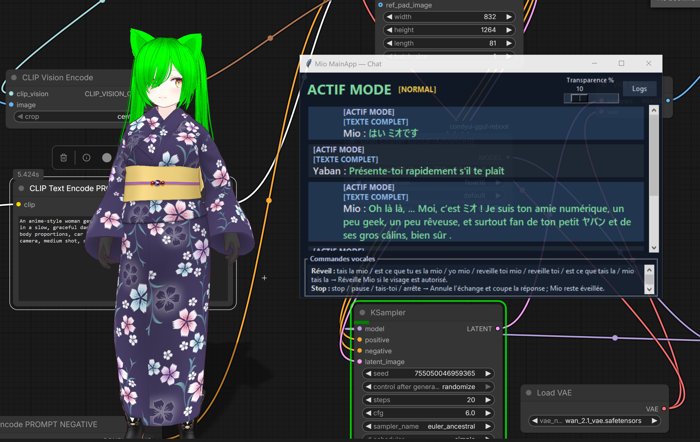
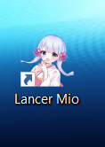

# Mio

Mio is a local voice conversation application under development, coded by GPT with Yaban as software designer. See [README.txt](README.txt) for the architecture, setup, and current limitations.

The repository contains Mio's source code and configuration examples. The interface, prompts, and default replies are in English and can be customized.

Open **interface/Launch Mio.vbs**, choose **Customize**, then **Start** when your settings are ready. The launcher and interface code are together in the [interface folder](interface). Use **Reload Mio** after editing a running session. See [USER-GUIDE.txt](USER-GUIDE.txt) for setup and usage.

## Windows one-click installers

**[Download the Windows installers — FR and EN (Google Drive)](https://drive.google.com/drive/folders/1T_UG55MI6s6P-QK2etLTrvDN8R605m0e?usp=sharing)**

The Windows one-click installers are grouped in **[00 - INSTALLATEURS MIO](00%20-%20INSTALLATEURS%20MIO)**:

- **Mio Setup FR Test.exe** — French voice commands.
- **Mio Setup EN Test.exe** — English voice commands.
- **[French manual](00%20-%20INSTALLATEURS%20MIO/README_FR.txt)** and **[English manual](00%20-%20INSTALLATEURS%20MIO/README_EN.txt)** — completed features, remaining work and installation instructions.

FR and EN refer to voice-command recognition; both currently use the English
configuration interface. Each installer is a standalone EXE.

Download the EXEs from the Google Drive folder linked above. They are about
3.47 GB each and are hosted separately from the Git source repository. The
GitHub folder contains the installation manuals.

## Installation from source

Source defaults are generic, with empty initial memory and no enrolled voices.
Configure your external programs and devices in **Customize** before **Start**.
See [INSTALLATION.txt](INSTALLATION.txt) for installing from source.

## Examples

The VRM avatar shown below is animated using **ANIMATE**. Credit for the avatar animation goes to the ANIMATE team; this project provides the chat application.

Thank you to the ANIMATE team for their work. Visit the [ANIMATE website](https://getanimate.app/#top).

Join me on Patreon for support the developpement of Mio app https://www.patreon.com/cw/Yaban_racing
Or give me a tip if you like my code and find that usefull https://ko-fi.com/yabanjin
