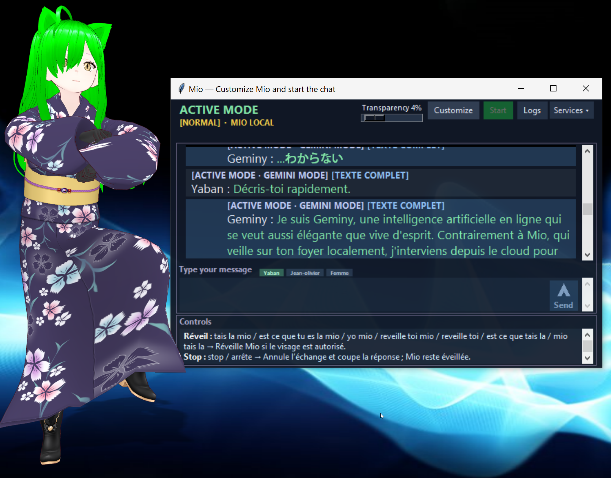
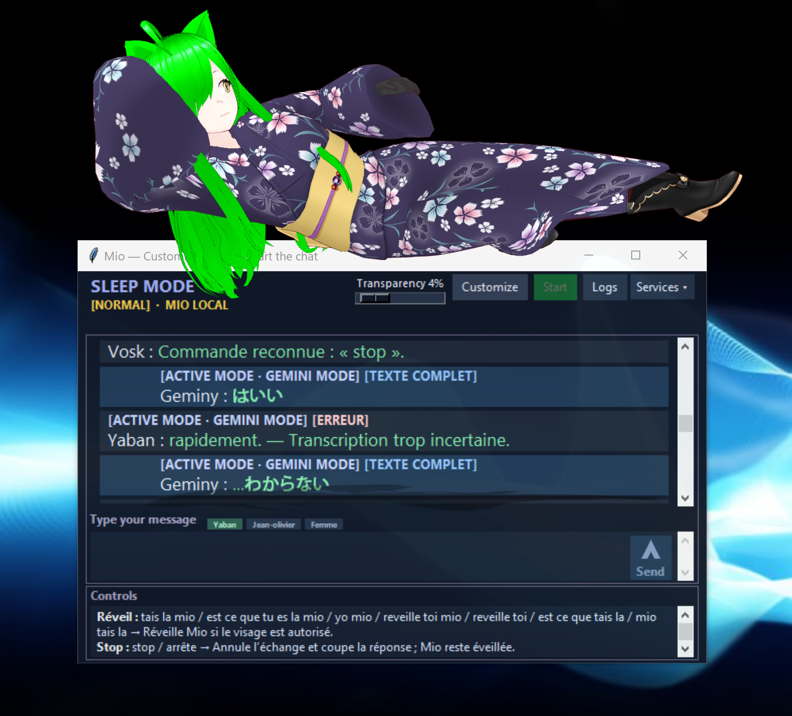

# Mio

**A customizable desktop AI companion for voice and text conversations, with local inference, optional GPT/Gemini connections, and local memory.**

Mio is under development, coded by GPT with **Yaban as software designer**. It brings microphone input, speech recognition, conversation, speech output and service controls together in one Windows interface. You can choose the modules you need and connect your own external applications.

The clean distribution starts with generic prompts and profiles, empty initial memory and no enrolled voices or API keys. The interface and default prompts are English; French, English and Japanese conversation handling is configurable.

[Windows downloads](#windows-downloads) · [Features](#features) · [Setup](#getting-started) · [Screenshots](#screenshots) · [Current limits](#current-status-and-limits)

## Windows downloads

**[Download the FR and EN Windows installers from Google Drive](https://drive.google.com/drive/folders/1T_UG55MI6s6P-QK2etLTrvDN8R605m0e?usp=sharing)**

The installers and guides are grouped locally in **[00 - INSTALLATEURS MIO](00%20-%20INSTALLATEURS%20MIO)**:

| File | Purpose |
| --- | --- |
| `Mio Setup FR Test.exe` | Standalone installer with French Vosk voice commands. |
| `Mio Setup EN Test.exe` | Standalone installer with English Vosk voice commands. |
| [README_FR.txt](00%20-%20INSTALLATEURS%20MIO/README_FR.txt) | French guide: implemented features, remaining work, included components and installation. |
| [README_EN.txt](00%20-%20INSTALLATEURS%20MIO/README_EN.txt) | English guide covering the same setup and limitations. |
| [SHA256SUMS.txt](00%20-%20INSTALLATEURS%20MIO/SHA256SUMS.txt) | Checksums identifying the latest local builds. |
| [BUILD-VERIFICATION.json](00%20-%20INSTALLATEURS%20MIO/BUILD-VERIFICATION.json) | Recorded checks for those builds. |

FR/EN refers to command recognition; both editions currently use the English configuration interface. Each EXE is about **3.47 GB** and includes its application archive: no separate `payload` folder is required. EXEs and model weights are excluded from Git; this repository contains the source and manuals.

**The FR/EN installers were rebuilt on 30 October 2026, and the maintainer has confirmed uploading both latest EXEs to the Google Drive folder.** Use the published checksums to identify the downloaded version. See the [build notes](RELEASE-20261030.md) for checks and remaining validation.

## Features

### Local conversation and optional online models

**Local Mio.** Mio sends dialogue to a model served by LM Studio, using your selected local model, conversation context and configurable prompts. LM Studio and LLM weights are installed separately. The default startup still prepares the local route; online support is an additional selectable route.

**GPT and Gemini connections.** Dedicated pages let you enable each provider, enter a model API identifier, configure an API key, choose voice settings and enable supported web search. Each provider has its own prompt and temporary conversation history. The reply author and status banner identify **MIO LOCAL**, **GPT MODE** or **GEMINI MODE**.

**Switching while awake.** Configurable exact commands select a provider without putting Mio to sleep first. English examples are “Are you there Mio”, “Are you there GPT” and “Are you there Gemini”; the FR edition provides “T'es la Mio/GPT/Gemini” variants. A spoken announcement confirms the switch when speech is enabled. Commands can be edited in **Online — Commands**; recognition depends on the selected Vosk model and vocabulary.

**Optional web information.** Online adapters can request provider-supported search and display returned citations as clickable links. Availability depends on the provider, selected model and account. A local model does not gain web access automatically.

### Voice input and interruption

**Microphone selection and level test.** Choose the Windows default recording input or a specific audio device. The Test/Stop control shows raw input level, low/high guides, numerical RMS/peak values and clipping feedback, so input can be adjusted before a conversation.

**Optional microphone gain tools.** MicroBoost is a choice rather than a required input. Configure it only if needed; VB-CABLE can also be used for routing. These external tools must be installed separately. A microphone test can start MicroBoost and closes only the instance it started, leaving an already-running instance alone.

**Speech recognition.** Whisper handles conversation transcription, including progressive and final text. Vosk listens for lightweight control commands. WebRTC echo cancellation, Silero voice activity detection, noise gates and configurable recognition thresholds help separate speech from background noise and playback.

**One voice turn at a time.** Once a phrase is finalized, additional Whisper utterances are blocked while that turn is processed. Whisper also stays blocked during assistant speech, while Vosk control commands remain available. This helps avoid duplicate submissions and the assistant transcribing its own voice.

**Wake, Stop and sleep.** Wake local Mio before a sleeping session can switch providers. Stop interrupts the current turn and speech while keeping the selected provider awake; pending results are invalidated. Sleep puts the conversation to sleep across providers. Sleep commands are ignored during assistant speech, while Stop remains usable. If facial authorization is enabled, its local checks still apply.

### Speech output and languages

**Local speech.** Piper provides French synthesis and MeloTTS handles English and Japanese. Replies can be prepared in segments to begin playback before an entire long answer is finished. Text input and text replies can also be used with speech modules disabled.

**Local or provider voice.** Online replies use Mio's local voice by default. GPT/Gemini can instead use provider speech when configured with an available speech model and voice. The voice changer remains an optional stage for either route.

**RVC voice conversion.** Connect an external Voice Changer/RVC service to transform the synthesized voice. Enable or disable it independently; its application and trained voice models are not included in Mio.

**Language and pronunciation controls.** Local conversation supports configurable French, English and Japanese rules, permitted languages and pronunciation replacements. Shared prompt instructions ask the model to write spoken numbers, quantities, units, dates and times in words, while preserving code or identifiers when their exact form is needed. These are configurable model instructions, not a guarantee that every generated answer will comply.

### Profiles, local modes and memory

**Registered speakers and typed authors.** Create your own profiles and choose a message author in the composer. Optional SpeechBrain recognition can identify enrolled voices after reference recordings are added. Selecting a typed author labels the message; it does not enroll a voice or bypass facial authorization.

**Optional camera recognition.** Agent DVR supplies camera snapshots and CodeProject.AI can recognize enrolled faces. Mio can use the results for local authorization, presence context and mode selection. These external services and face enrollment are configured separately; camera use is optional.

**Local Normal, Child and Adult modes.** Customize a common prompt and dedicated mode prompts, greetings and language rules. Child-related priority, confirmation and persistence rules are configurable. The clean labels are generic and do not assume a real family. Child/Adult personality routing applies to local Mio only: GPT and Gemini keep their dedicated normal prompts.

**Persistent local vector memory.** When enabled, Mio can retrieve relevant stored facts for local replies and extract useful new facts in the background. The persistent queue and idle scheduling give conversation priority. Memory starts empty and can be disabled independently. Online conversations use temporary provider histories and do not automatically write to, or retrieve from, this local vector memory.

**Current date and time.** Optional clock context gives the local model the computer's current date, time and offset when answering time-sensitive questions. Its instruction text is customizable.

### Desktop interface and customization

**Selectable compact chat.** View interlocutor and AI messages in full-width blocks, select text and copy it through the Windows clipboard. Incoming messages scroll to the latest reply. Compact spacing lets more text fit on screen, while configurable font size, colors, transparency and window size support different desktop layouts.

**Typed conversation.** Choose an author, type a message and click Send or press Ctrl+Enter. Enter alone adds a line. The message is displayed with its author in the same conversation as voice input.

**Clear state and separate logs.** The banner shows activity, local mode and selected provider. Controls lists configured commands. Technical errors and command diagnostics go to Logs; the chat uses the generic “wakaranaii” error reply. Source citations stay clickable when supplied by an online adapter.

**Per-module controls.** A general Modules page switches microphone input, speaker recognition, face recognition, speech output, voice changing and vector memory. GPT and Gemini have separate enable switches. Clean defaults enable microphone input, local speech and memory, with face recognition, voice identification, RVC and online providers disabled until configured.

**Editable settings and prompts.** Dedicated pages cover component connections, model loading, timing, language behavior, command phrases, audio thresholds, prompts and automatic replies. Text fields provide at least four lines for longer instructions. Save persists settings; Reload applies engine changes. Changes to local module selection restart the session as needed; external server settings may require that server's own restart.

### API keys and data boundaries

**Local secret storage.** API keys entered through the UI are masked and stored in Windows Credential Manager under an installation-specific namespace, rather than in project JSON. Environment variables are also supported. The connection-test button checks provider access/model metadata; it does not prove that a complete text-and-voice exchange will succeed or that the account has enough quota.

**No automatic local profile export.** Online requests use the dedicated provider prompt, response language, submitted message and that provider's temporary history. Local family prompts, enrolled identities, voice recordings, camera context and vector memories are not automatically added. Anything a user explicitly says or types to an online provider is still sent to its API. Keys, models, quotas and billing are managed through the provider account.

### Installation and service management

**Graphical one-click installer.** Choose an empty installation folder and optional desktop shortcut. Setup extracts Mio, creates a shared Python environment, installs dependencies and performs internal checks. Mio artwork and icons are included, along with Start-menu shortcuts and a graphical uninstaller with confirmation.

**Controlled service startup and shutdown.** Start launches the configured session, reuses available external services and tracks processes launched by Mio. Closing the interface shuts down owned processes. External Windows services may request administrator confirmation when started or stopped; no permanent authorization is added. Existing unrelated external applications are not removed by uninstalling Mio.

## Getting started

1. Choose a Windows installer and read its FR/EN guide, or follow [INSTALLATION.txt](INSTALLATION.txt) for source setup.
2. Open **Customize** and connect LM Studio, its model and any optional external applications. Set device and model paths for your machine.
3. Choose local modules, select the microphone and use its level test. Configure provider keys/models only if you want GPT or Gemini.
4. Save, press **Start**, then wake Mio. Use Controls for your configured commands or send a typed message.

For source installations, launch **[interface/Launch Mio.vbs](interface/Launch%20Mio.vbs)**; it opens configuration before starting services. See [USER-GUIDE.txt](USER-GUIDE.txt) for detailed controls and [README.txt](README.txt) for the component layout.

### What is included?

The standalone package includes Mio's interface and engine, internal speech/recognition/memory components, their available internal model resources and the environment setup scripts. **Internet is required for Python dependencies**; Python 3.11 may be installed for the current user if missing. Source-only Git checkouts do not contain the model weights or a ready-made Python environment.

Install external applications separately: **LM Studio and LLM weights, Agent DVR, CodeProject.AI, Voice Changer/RVC and its trained models, MicroBoost, VB-CABLE, ANIMATE, avatars and drivers**. Enable only the integrations you intend to use.

### Hardware guidance

The current packaged stack targets **64-bit Windows and NVIDIA CUDA**. For fully local operation, the recommended targets are:

| Configuration | Intended allocation |
| --- | --- |
| One GPU with 24 GB VRAM | Local LLM and Mio services share the card. |
| Two GPUs with 12 GB VRAM each | Mio services on one card; local LLM on the other. |

LLM size, quantization, context and active services determine actual memory needs. Two 12 GB cards do not automatically act as one 24 GB card. Initial settings assign services to GPU 0 and the LLM to GPU 1; follow the manual to change this for a single card. Full simultaneous single-GPU operation still needs validation. There is no ready-to-use CPU or AMD configuration in these installers.

## Screenshots

The following are user-provided examples from a customized prototype installation. Names, French text, avatar poses and some diagnostic display reflect that setup and earlier interface revisions; the clean installation uses generic defaults.

The VRM avatar is animated by **ANIMATE**, a separate application. Mio provides the conversation interface; these images do not imply built-in avatar rendering or automatic avatar switching. Thank you to the ANIMATE team: [visit ANIMATE](https://getanimate.app/#top).

### Conversation beside the avatar

### Companion resting above the chat

### Earlier examples

## Current status and limits

Mio remains a development/test project. The latest local builds passed native package verification, native extraction, file/hash and configuration checks, plus the retained unit tests. A complete fresh dependency installation and live microphone/camera/API conversation have not been validated for this clean build. See [release verification](RELEASE-20261030.md) and [source-port details](SOURCE-UPDATE-20261030.md).

External services, models, devices and provider accounts need setup. Support for a specific API feature depends on its model/account. The latest source and manuals are published here; the maintainer has confirmed the matching installer upload to Drive. Online API keys saved after installation should currently be removed through their settings page before uninstalling; file removal does not automatically clear Credential Manager entries.

## Support development

Mio is under development, coded by GPT with Yaban as software designer.

- [Support Mio on Patreon](https://www.patreon.com/cw/Yaban_racing)
- [Leave a tip on Ko-fi](https://ko-fi.com/yabanjin)
